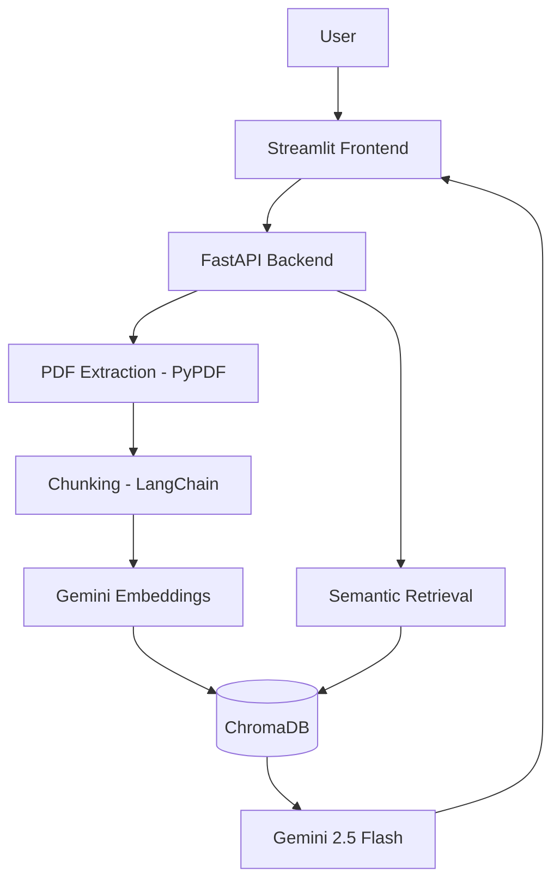
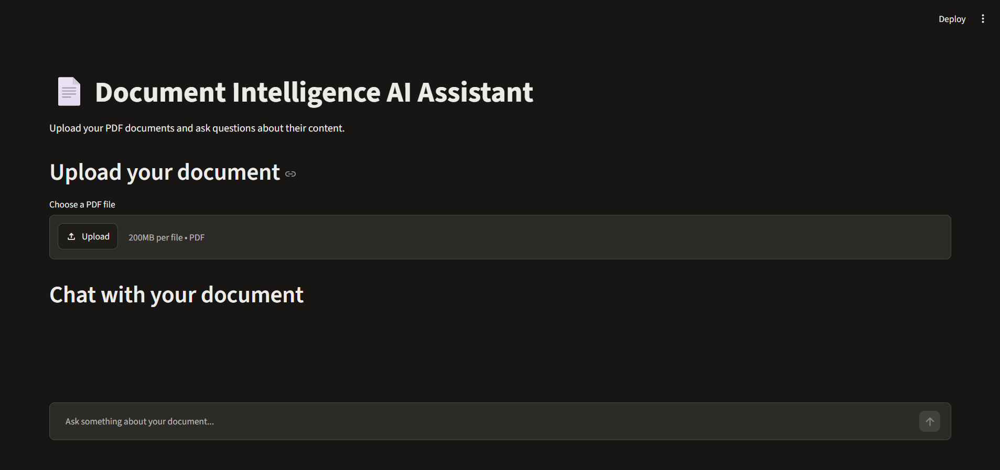
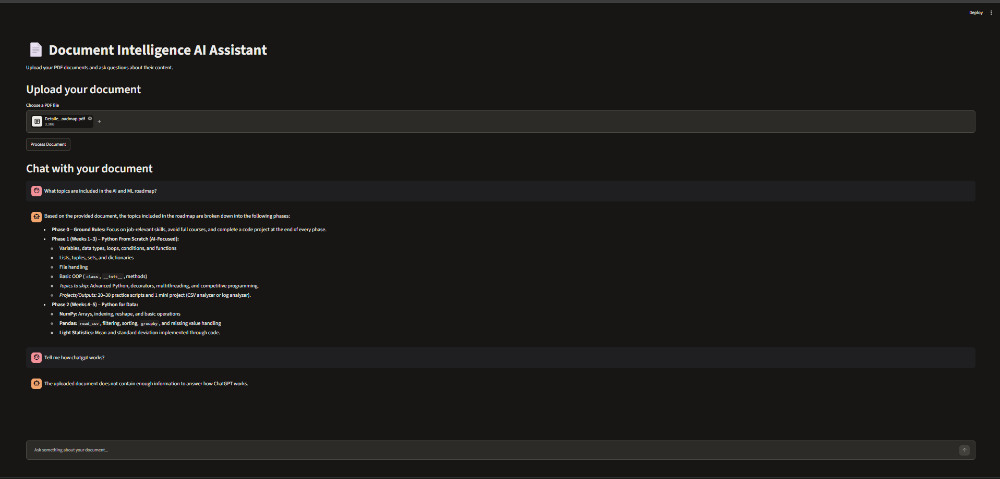

# 📄 Document Intelligence AI Assistant

A GenAI-powered document question-answering application built using **Retrieval-Augmented Generation (RAG)**. Upload PDF documents and ask questions to receive context-grounded answers using Google's Gemini models.

## 🚀 Features

- PDF upload and text extraction using PyPDF.
- Document chunking using LangChain.
- Text embeddings using Gemini Embeddings.
- Vector storage and semantic search using ChromaDB.
- Context-grounded answers using Gemini 2.5 Flash.
- Interactive chat interface using Streamlit.
- FastAPI backend with input validation and error handling.

## 🛠️ Tech Stack

| Component | Technology |
|---|---|
| Language | Python |
| Frontend | Streamlit |
| Backend | FastAPI |
| LLM | Gemini 2.5 Flash |
| Embeddings | Gemini Embedding 001 |
| Vector Database | ChromaDB |
| Document Processing | PyPDF |
| Chunking | LangChain |

## 🏗️ Architecture



## 📸 Application Screenshots

### Home & Document Upload


### Document Upload


### AI Chat Interface


## ⚙️ Setup & Installation

**1. Clone the repository**

```bash
git clone https://github.com/Indrajith15/document-intelligence-ai-assistant.git
cd document-intelligence-ai-assistant
```

**2. Create and activate a virtual environment**

```bash
python -m venv .venv
```

Windows:

```powershell
.\.venv\Scripts\Activate.ps1
```

**3. Install dependencies**

```bash
python -m pip install -r requirements.txt
```

**4. Configure your API key**

Create a `.env` file:

```env
GEMINI_API_KEY=your_gemini_api_key
```

Get your key from [Google AI Studio](https://aistudio.google.com/apikey).

**5. Run the backend**

```bash
python -m uvicorn backend.main:app --reload
```

**6. Run the frontend in another terminal**

```bash
python -m streamlit run frontend/app.py
```

Frontend: `http://localhost:8501`

API documentation: `http://127.0.0.1:8000/docs`

## 🔌 API Endpoints

| Method | Endpoint | Description |
|---|---|---|
| GET | `/` | Welcome endpoint |
| GET | `/health` | Health check |
| POST | `/upload` | Upload and process PDFs |
| POST | `/ask` | Ask document-related questions |

## 🔮 Future Improvements

- Multi-document support.
- Source citations with page numbers.
- User authentication.
- Persistent cloud vector storage.
- Cloud deployment.

## 👨‍💻 Author

**Indrajith Nair**

Aspiring AI / Generative AI Engineer.

[GitHub Profile](https://github.com/Indrajith15) · [Project Repository](https://github.com/Indrajith15/document-intelligence-ai-assistant)

---

*Built as a hands-on project exploring RAG, LLMs, embeddings and vector databases.*
